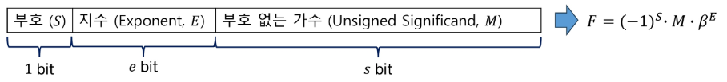

# 1-1 기계학습
## 1. 지도학습의 개념

## 2. 회귀 (Regression)
: 연속적 수치

### 2-2 평균제곱오차(MSE)
- 정답과 예측의 평균 제곱 차이값
- 틀린 정도를 제곱해서 더 큰 오류에 패널티

### 2-3 결정계수(R**2)
- 모델이 실제값을 얼마나 더 잘 맞추는지를 0~1 사이 값으로 표현

## 3. 분류

### 3-2. 정확도(Accuracy)

### 3-3. 혼동행렬
- 1종 오류(FP)
  - 실제 음성인데 양성(오탐)
-  2종 오류(FN)
   - 실제 양성인데 음성(누락)

  | 정밀도(Precision)
    "양성 판정" 중 진짜 양성
    = TP/(TP+FP)
  | 재현율(Recall)
    "진짜 양성" 중 예측한 양성
    = TP/(TP+FN)
  | F1-score
    정밀도와 재현율의 조화평균

### 3-4. 교차 엔트로피

### 4-2 오버피팅(overfitting)

# 4-1 LangChain

## 1. Environment Representation & Understanding

(밝혀지지않은)복잡합 환경 보완
1. 프로프트
2. 비지도 프롬프트 유도
   - 명령을 검색을 해오고 이용
      
      (부족한 경험을 검색을 통해 보완)
   - 환경탐색
      
      호기심 기반 보상

3. 탐색 기반 궤적 기억
   - LM-agent 환경 탐색
   - LM-labeler 자기 교정

## 2. Reasoning & Planning

- Local Planning
  - 툴(tool)
  - 추론 - 관측(action) 순환
  - 웹 탐색, Q&A 강점
  
- Global Planning
  

| 오류 식별과 회복(Error identification and Recovery)
- Reflexion (Shinn et al.. 2023)
  - 수행 - 오류 분석 - 재시도 - 회복
  
| 계획 재검토(Revisiting Plans)
- CoAct (Hou et al.. 2024)
  - 두 개의 에이전트가 서로 협력 

## 3. Langcahin

- 다양한 데이터/ 툴

# 4-2 Agent 모델

## 1. AI Agent
|에이전트 : 대신하여 특정 작업을 수행하고, 결정을 내리며, 합의를 도출

## 2. Multi-Agent System

### 2-1. Multi-Agent System

- 집단 지성
- 지능형 에이전트들이 협력하고 지식을 나누고, 함께 문제를 해결 (수평적 확장)

### 2-2. 방법론 : 협업 유형
| 협력
- 에이전트 각자의 개별 목표를 공동의 집단 목표와 일치, 상호 이익이 되는 결과 달성
  

| 경쟁
- 에이전트 각자 개별 목표를 우선시, 다른 에이전트들의 목표와 충돌하거나 대립할 수 있는 경쟁 요소 도입
- --> 고도의 추론 능력과 더 창의적인 문재해결

| 협력과 경쟁의 조합
- 전략적 조합
- 전문가 혼합 모델 (MoE, Mixture-of-Experts) 

### 3. 방법론 : 협업 전략

| 규칙 기반 프로토콜
- 사전에 정의된 규칙
- 인간 협력 방식 모방

| 역할 기반 프로토콜
- 사전에 정의된 역할
- 주로 도메인 지식에 기반

### 4. 방법론 : 커뮤니케이션 구조

| 중앙집중형 구조
- 참여자-서비스 제공자 구조
- 중앙 에이전트

| 탈중앙화 구조
- 에이전트에 대한 통제 및 의사결정 분산

| 우려의 시사점
- 확장성 고려사항
- 최적 협업 전략
- 적응가능한 역할 및 협업 경로 할당

## 3. Memory & Tool in Multi Agent System

### 3. Memory & Tool
| 언어모델 (LLM) --- > AI 에이전트

- 기억/지식
- 행동/능동성
- 학습/적용

LLM ----> RAG ----> 에이전트형 RAG

| 멀티 에이전트 시스템을 위한 훈련 방법

(
- Toolformer : 언어모델이 스스로 도구 사용법 학습
- Gorilla : LLM 을 대규모 API 와 연결
- ReTool : LLM 의 전략적 도구 사용을 위한 강화학습
- Search-R1 : LLM 을 사용한 더 나은 웹 검색을 위한 강화 학습

)

| 모델 컨텍스트 프로토콜 (MCP)
- 정의:
  
  AI 모델이 외부 도구, 리소스, 환경과 원활하게 상호작용할 수 있도록 하는 표준화된 인터페이스 "AI 기능의 USB 같은 역할"

- 도구의 재사용성과 연결성이 극대화

| Agent2Agent 프로토콜
- 목표:

  여러 AI 에이전트가 서로 협업

  (내부 메모리, 사고, 도구 공유하지 않고 맥락, 작업, 지시사항, 데이터만 교환)

## 4. Reasoning and Planning in AI Agent

### 1. LLM 의 추론 능력
- 유도
  - 프롬프트
- 강화
  - 자기 일관성
  - Tree of Thoughts

### 2. LLM 에이전트의 계획 수립 (Planning)

- ReAct : '생각'과 '행동'을 함께 생성
- HuggingGPT : 계획 수립을 담당하는 LLM이 각각의 전문 모델들에게 작업 분배
- Plan-and-Act : 
  
  계획 에이전트는 거시적인 계획을 생성, 
  
  실행 에이전트는 해당 계획에 따라 하위 단계를 실행

### 3. 추론 시간 연산량 최적화 및 효율적 추론 접근법

- 추론 시에 컴퓨팅 자원을 더 많이 투입할수록 LLM의 성능 향상
- 정확성과 올바른 형식에 대해서만 보상 제공, LLM이 chain-of thought을 사용하는 방법을 학습-강화
  
| 효율적인 추록
- 가변 길이
- 동적 추론
- 입력 프롬프트 기반 접근 (라우팅)

## 5. Domain-Specific AI Agent

### 1. Deep Reasearch
웹 검색 --> LLM 챗봇 --> RAG(검색 증강 생성) --> 에이전트 기반 심층 연구

### 3. 에이전트 기반 심층 연구
    - 추론과 검색을 결합
    - 동적 피드백 루프 (Self Regression)
    - 능동적 정보 탐색 에이전트
    - 문서를 읽고 다른 도구나 에이전트와 협력

| 역동적인 환경에서의 어려움과 해결방안          
  - 검색 결과 부정확 --> 한계
  - 적응력 한계
  - 효율적 리소스 할당

| 강화학습 기반 훈련 및 보상 설계
- 프롬프트 - 지도학습 - 강화학습

| Test-Time Scaling(TTS)
- 정의 : 추론/검색 단계 수를 늘리면 성능 향상 (TTS 법칙)
- 추론 TTS
- 검색 TTS
- Trade-off

| 방법론 - 문제 해결 과정
- 생각 -> 도구 사용 -> 생각 -> ... -> 답변 사이클 반복

| 역동적인 환경에서의 어려움과 해결방안
- 많은 요청 동시 처리
- 웹 크롤링 및 API 제약
- 정보 추출 효율성 문제

| 창발적 행동

| 한계점 및 고려사항
- 높은 비용 (토큰)
- 범용성의 한계
- 에이전트 관리의 복잡성
- 상태 관리 및 오류
- 평가 및 디버깅의 어려움

## 5-1 리소스 효율적 AI모델

### 1. 컴퓨터의 수 체계
#### 1-1. 고정소수점 수 체계

kilo (2^10) - mega (2^20) - giga (2^30)

Bits, Bytes, Nibbles...
- Most Significant Bit(MSB) : 이진수에서 가장 왼쪽 비트, 가장 큰 자리값
- Least Significant Bit(LSB) : 이진수에서 가장 오른쪽 비트, 가장 작은 자리값
- Nibble : 4비트로 이루어진 데이터 단위

| 부호-크기 표현 방식
- 최상위 비트를 부호 비트로 0이면 양수, 1이면 음수

  | 문제 발생
  - (-6 + 6) 즉 0을 표현 못함
  - 0을 표현하는 방식 두 가지
    - 1000
    - 0000
  
| 2의 보수 표현 방식
- 모든 비트를 반전한 뒤 1을 더하기

  | 기존 덧셈이 정상적으로 동작
  - -2 = 1110 = -4 + 2

| 비트 폭 확장
- 부호 확장 (sign extension) : 최상위 비트를 복사해 상위 비트 채움 (값 유지)
- 제로 확장 (zero extension) : 상위 비트를 0으로 채움 (패턴 유지, 값 달라짐)

| 이진 수 체계 정리
 - 4bit는 int, 8bit는 long

| N-bit 패턴이 꼭 정수일 필요는 없음
- 정수부와 소수부를 함게 표현 가능
- 이진 소수점 위치는 실제 저장하지 않음
  - 사용자가 제한 없이 해당 위치 정함
  - 덧셈과 뺄셈은 동일하게 동작

#### 1-2. 부동소수점 수 체계

| 아주 크거나 아주 작은 수
- 고정소수점으로 표현하기엔 너무 많은 비트가 필요로 함
- 지수를 활용한다면? 큰/작은 수를 더 적은 문자로 표현 -> 대신 유효숫자의 개념 도입!

| 부동소수점
- 지수를 활용하여 수를 표기
- 소수점이 고정되지 않고 둥둥 떠다니는 것으로 해석!

| 정해진 자리 수만 사용해서 부동소수점 "잘" 표현하기
- 가수는 고정소수점 체계
- 언제나 x.xxxx * 10^x 형태로만 표현하기로 약속 -> 정규화(normalization)

| 유효숫자 그 다음은 어떻게 처리?
- 반올림 (round to nearest)
- 올림 (round to toward +inf)
- 버림 (round to toward -inf)
- 절삭 (round to toward zero)
- 오류를 최소화 하기 위한 다양한 rounding 기법

| 지수적 표현을 이진 수 체계에 접목하는 법

- 가수는 보통 [0,1), [1,2) 형태
- 밑(B) -> 일반적으로2의 거듭제곱

| 정규화된 이진 부동소수점 수 체계
- 부동소수점은 유일한 표현이 아님에 주의
- 일반적으로 0으로 시작하는 패턴을 피하고자 함 -> 정규화
- 정규화 : 첫 4칸안에 1이 하나는 있어야 함
- 한계 : 정규화된 표현은 0을 포함하지 않음

| 바이어스/편향 지수 (biased exponent)
- 0부터 시작 --> 부호는 떼고 값만으로 대소 비교 --> 대소비교가 쉬워짐
- 지수 초과 : 상한초과 (overflow, )
- 지수 미달 : 하한초과 (underflow, 값을 0으로 표현)

#### 1-2. 부동소수점 표준 (IEEE)

| 주요 특징
- Base-2
- Hidden bit 사용 : 1.xxxx 형태로 가수를 정규화, 맨 앞의 1을 f에 저장하지 않음
- 8-bit 지수에 bias를 127로 사용

| 조금이라도 넓은 표현범위를 위한 노력 (IEEE vs DEC)
- 지수 bias: 128 대신 127 사용
- 가수에 Hidden bit -> 지수에 1 더하기
- 양의 방향 범위

| 특수 표현
- 비정규화 수

#### 1-3. 연산과 복잡도
#### 1-3. 고정소수점 수 체계의 연산
| 이진 수 체계 정수의 덧셈
- underflow 없음
- Carry out 과 overflow 는 다름
- 
| 이진 수 체계 정수의 곱셈
- overflow 주의

| 이진 수 체계 정수의 나눗셈
- 복잡함

### 2-1. 모델 경량화의 필요성

### 2-2. 양자화(Quantization)
| 연산/메모리 부하를 줄이는 가장 직관적인 방법

| QAT vs PTQ(Post-training quantization)

| Weight-activation vs Weight-only

| Symmetric(대칭) vs. Asymmetric : Asymmetric 승

| Integer vs. Floating-point : Floating

| Mixed=precision quantization
- Layer 별로 최적화된 quantization 적용

#### 2-2. 가지치기 (Pruning)

| 불필요한 weight 제거
- 모델크기 줄어듦
- 살아남은 weight 위치 기록
- 압축 해제 과정이 GPU (병렬) 와 궁합이 안 좋음 -> 속도 이득보기 어려움

| Pruning rule?
- magnitude-based pruning
  
| Unstructured vs. Structured
- 어떤 weight가 살아남을지 예측 어려움 (랜덤, Unstructured) : 병렬 처리 어려움, 속도 이득 어려움
  
  --> regular 한 패턴을 갖고 날리자(Structured) -> GPU 와 궁합이 좋아짐

| Indexing data format
- 가장 일반적으로 쓰는 CSR -> 하지만 pruning ratio 가 극단적으로 높아야 GPU 가속

| Fine-tuning/retraining 가능 여부
- CNN 기반 이미지 처리는 80%이상
  p. 104
- LLM 계열은 50% 내외
  p. 105

| GPU 호환여부

#### 2-2. 지식 증류
| 작은 모델을 만드는 효과적 방법
- 똑똑하지만 매우 큰 모델에서 출발(teacher)
- 두 가지 loss를 정의: Total loss= Student loss + Distillation loss
- 조교 활용하기(Assistant model)
  - 선생님이 너무 똑독하거나 학생의 잠재력이 너무 뛰어나도 효율이 떨어짐
  --> 조교 도입

| LLM distillation
- 상대적으로 작은 LLM에서 기존(엄청나게 큰) LLM 활용
  - 처음부터 그냥 학습하는 것 보다 성능 뛰어남

### 2-3. LoRA/QLoRA

#### 2-3. 파인 튜닝

| 모델 경량화 관점
- 원본 모델의 크기를 줄이는 과정
- 
| 모델 서비스 관점
- 일반적인 능력은 강한 원본모델 -> 특정 영역/도메인에 특화(추가 학습)

| 튜닝 방법론
- In-context 학습
  - 원하는 방향으로
- Full fine tuning
  - 모든 weight를
  - 비용 부담
  - 사실상 그냥 새로운 모델만드는 것과 다를 바 없음
  - 정보의 망각

| 파라미터 효율적 파인 튜닝 (Parameter Efficent Fine Tuning, PEFT)
- LLM 을 도메인 특화 시키는 과정의 복잡도 개선
  - 전체 weight 말고 일부 weight 만 특화
  - 그 일부를 어떻게 선택할까
    - Adapter layer
      - 원본에 새 layer를 추가
      - Full tuning보단 적지만, 상당히 많은 추가 layer가 많음
      - 원본 모델 구조가 바뀜
    - Prompt tuning
      - 가짜 토큰 추가
      - 아주 적은 추가 weight
      - 매우 가볍고 빠르고 배포가 쉬우나 표현력의 한계(똑똑해지지 않음)로 성능에 제한
    - Low-Rank Adaptation (LoRA)
      - 적은 weight 로 전문가로 만들 수 잇음

| Quantized Low-Rank Adaptation (QLoRA)
- 경량화(quantization) + LoRA
  - 우선 원본 모델을 강하게 quantization -> 범용 성능 하락
    --> but 파인 튜닝할 거라 ㄱㅊ
  - 높은 해상도를 유지하며 학습
    --> 원하는 task에 대해선 높은 재학습으로 인해 높은 성능
  - 속도 느려짐
  - 모델을 최대한 압축하고 싶을때 - 원하는 부분에 높은 layer 끼워넣기
  
